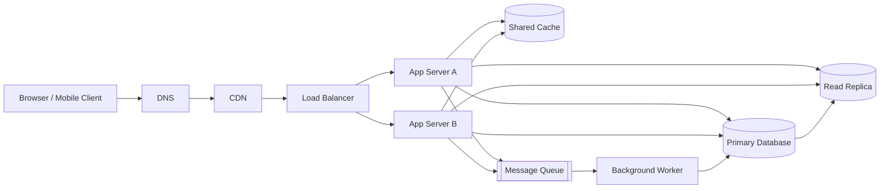

# QuickNotes Architecture

## Requirements

**Functional:** users can register and authenticate; create, list, view, edit, and delete private notes; create tags and filter notes by tag; and paginate through results.

**Non-functional:** enforce per-user authorization and encrypt traffic; keep common reads responsive (target p95 below 250 ms); maintain 99.9% monthly availability; scale app servers horizontally; preserve committed writes with automated backups and recovery; and monitor errors, latency, and saturation.

## Estimate for 1 million users

Assumptions: 20% of users are active each day (200,000 DAU); each active user reads 20 notes and creates 2 notes per day; peak traffic is 10 times the daily average; each stored note averages 2 KB including typical row/index overhead. This is a planning estimate, not a measured workload.

| Measure | Calculation | Estimate |
| --- | --- | --- |
| Average reads | 200,000 × 20 / 86,400 | ~46 reads/second |
| Peak reads | 46 × 10 | ~463 reads/second |
| Average writes | 200,000 × 2 / 86,400 | ~4.6 writes/second |
| Peak writes | 4.6 × 10 | ~46 writes/second |
| New storage/year | 200,000 × 2 × 2 KB × 365 | ~292 GB/year before backups and replicas |

The estimate excludes edits, deletes, user/tag rows, and unusually long note bodies. Storage capacity should include indexes, replicas, backup retention, and growth headroom beyond the logical data estimate.

## High-level architecture

The client is the user-facing application that sends authenticated API requests. DNS resolves the API hostname to the edge entry point. The CDN caches static assets close to users and reduces load on the origin. The load balancer distributes API traffic and removes unhealthy app instances from rotation. Two or more stateless app servers validate requests and can scale independently. The shared cache serves frequently requested note lists quickly and absorbs repeat reads. The primary database is the source of truth for transactional writes. The read replica handles eligible read traffic and reduces query pressure on the primary. The durable message queue buffers asynchronous work so a temporary worker slowdown does not block request handling. The background worker processes queued side effects such as search indexing and notifications.

For local development, VS Code's Live Server serves `index.html`, `style.css`, and `api.js` from the workspace and automatically refreshes the browser after edits; it is a static development server, not an API server or production CDN. The current demo client sends its GET, POST, and DELETE calls to JSONPlaceholder, while the production architecture routes API calls through DNS, CDN, load balancer, and app servers.

## Request flows

### `GET /notes`

1. The client resolves the API hostname through DNS and sends an HTTPS request through the CDN and load balancer.
2. The load balancer routes the request to a healthy app server, which validates the token and derives the user ID from the authenticated principal.
3. The app checks the shared cache using a key scoped to that user and the requested filters/cursor.
4. On a cache miss, the app queries the read replica for that user's newest notes; it uses the primary when a read-after-write consistency requirement applies.
5. The app stores the result briefly in cache and returns a paginated `200 OK` response; cache invalidation/versioning prevents stale entries from surviving note mutations.

### `POST /notes`

1. The client sends an authenticated JSON request through DNS, CDN, and the load balancer to a healthy app server.
2. The app validates the token, title length, body size, and ownership context, then starts a database transaction on the primary.
3. The primary inserts the note and commits; the app invalidates the affected user's cached note-list keys.
4. The app publishes a note-created event to the durable queue for non-critical asynchronous work, and returns `201 Created` with the note representation and `Location` header.
5. A worker consumes the event and updates search/notification systems; retries are idempotent, and a dead-letter queue captures events that exceed retry limits.

## Trade-offs and resilience

- **Read replica vs. immediate consistency:** replicas improve read throughput but replication lag can briefly hide a new note. Route read-after-write requests to the primary or return the created representation directly, while allowing ordinary list reads to use replicas.
- **Cache speed vs. invalidation complexity:** cached lists reduce database work but can be stale. Use short TTLs plus user-scoped version keys/invalidation after writes; the database remains authoritative.
- **Asynchronous work vs. eventual completion:** a queue keeps secondary work off the request path but adds operational complexity and delay. Persist/publish events reliably (transactional outbox), retry idempotently, and monitor queue age and dead letters.

No single network or compute instance is the sole serving path: DNS and load balancing use health checks and redundant endpoints, the CDN has multiple edge locations, and app servers are deployed across failure domains. The database uses a managed primary with synchronous/automated failover to a standby plus backups, and the queue is replicated across availability zones; recovery objectives and failover are regularly tested. A read replica is not itself a write failover strategy, so primary promotion and restore procedures remain explicit.